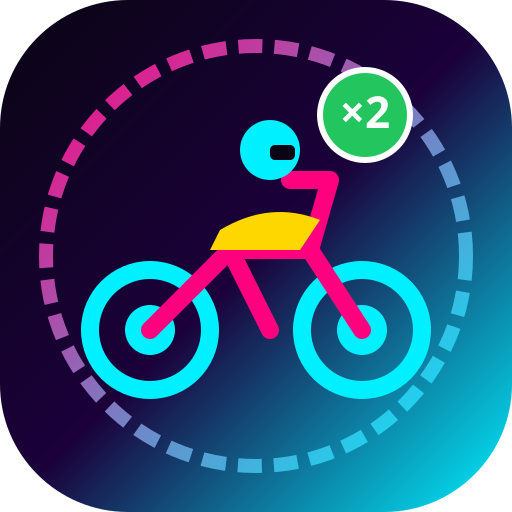

# MOTO RUSH 3D: CONVOY MAYHEM
## Production-Quality 3D Hyper-Casual Multiplier Gate Runner



> **"Start with one motorcycle. Make smart decisions. Build an enormous motorcycle convoy. Avoid destruction. Reach the finish line with the biggest fleet possible."**

**MOTO RUSH 3D: CONVOY MAYHEM** is a full-featured, commercial-grade browser 3D multiplier runner game built with TypeScript, Three.js, and Vite.

---

## 🎮 Gameplay Features

### 1. Mathematical Multiplier Gates
- **Addition Gates (`+5`, `+10`, `+20`)**: Expand your fleet with rapid reinforcements.
- **Multiplication Gates (`×2`, `×3`)**: Supercharge your convoy size.
- **Hazard Gates (`-5`, `-10`, `÷2`, `+50%`)**: Test your split-second reflexes and spatial awareness.
- **Single Activation Safety**: Deterministic collision checking guarantees gate effects apply exactly once without double-triggers.
- **Fleet Caps**: Logical fleet safely clamped between **1** and **9,999**.

### 2. High-Performance Convoy Formation
- **Hero Motorcycle**: Distinct procedural 3D model with wheel spinning, steering roll, and suspension physics.
- **Convoy Follower Fleet**: Rendered using GPU-accelerated **`THREE.InstancedMesh`** supporting up to 130+ simultaneous visual bikes.
- **Dynamic Wedge Formation**: Organised staggered rows that adjust to track bounds, compress laterally during tight steering turns, and recover smoothly.
- **Temporary Invulnerability**: Collision damage triggers an 0.8s invulnerability window with visual blinking to prevent rapid multi-wipe cascades. Convoy count never drops below 1.

### 3. Dynamic Obstacles & Hazards
1. **Stationary Barriers**: Orange hazard striped barricades (-2 bikes) & concrete jersey barriers (-5 bikes).
2. **Moving Traffic**: Procedural low-poly sedans driving in lanes with collision damage (-6 bikes).
3. **Oil Spills**: Reflective black slick puddles causing 2.2s of slippery steering drift.
4. **Spinning Turnstiles**: Rotating hazard bars creating timing challenges (-4 bikes).
5. **Crushers**: Hydraulic pistons slamming across lanes on timed intervals (-10 bikes).

### 4. Temporary Power-Ups
- 🛡️ **Shield**: Absorbs obstacle collisions for a duration.
- ⚡ **Turbo**: Increases forward speed with FOV warp and speed camera shake.
- 🧲 **Coin Magnet**: Magnetically pulls nearby coins toward the player within a 14m radius.
- 🔧 **Emergency Repair**: Restores a percentage of lost motorcycles.
- 🪙 **2x Coins**: Doubles the value of all coins collected during its duration.

### 5. 30 Data-Driven Campaign Levels Across 5 Environments
1. **Sunny City (Levels 1–6)**: Clear blue sky, modern glass skyscrapers, street trees, asphalt road.
2. **Coastal Highway (Levels 7–12)**: Sunset sky, ocean water plane, golden sandy beach, palm trees.
3. **Desert Expressway (Levels 13–18)**: Warm mesa canyons, saguaro cacti, red rock bluffs.
4. **Mountain Road (Levels 19–24)**: Misty alpine atmosphere, granite peaks, evergreen pine trees.
5. **Neon Future City (Levels 25–30)**: Cyberpunk synthwave grid, glowing monoliths, neon road stripes.

### 6. Endless Survival Mode
- Seeded procedural road chunk generation with progressive difficulty and dynamic speed scaling.
- Personal best distance and high score persistence.

### 7. Garage & Progression System
- **8 Unlockable Motorcycles**:
  1. *Street Racer*: Classic sport aerodynamics (Default).
  2. *Urban Comet*: Agile lightweight cafe racer.
  3. *Desert Rider*: Rugged off-road endurance dual-sport.
  4. *Thunderbolt*: High-voltage electric superbike.
  5. *Neon Phantom*: Cyberpunk stealth machine with glowing accents.
  6. *Velocity X*: Low-drag streamliner superbike.
  7. *Road King*: Muscular heavyweight chopper/cruiser.
  8. *Hyper Beast*: Predator-class hyper-naked hyperbike.
- **5 Permanent Upgrades** (5 Tiers each):
  - *Starter Fleet*: Start levels with up to +5 bonus bikes.
  - *Coin Magnetizer*: Permanent +10% to +50% bonus on collected coins.
  - *Shield Booster*: Extends shield duration.
  - *Nitro Overdrive*: Extends turbo duration.
  - *Emergency Repair*: Increases repair restoration potency.
- **Daily Challenges**: Deterministic daily missions reset by local calendar date.
- **Achievements System**: 8 milestone awards with coin prizes.

### 8. Web Audio API Procedural Sound & Music
- Zero external MP3/WAV dependencies! Works 100% offline with zero 404s.
- Dynamic motorcycle engine sound with pitch shifting based on speed and turbo.
- Gate chimes, multiplier fanfares, retro coin dings, and punchy collision crashes.
- Built-in 8-bar synthwave music sequencer with 4-on-the-floor kick, hi-hats, and arpeggios.

---

## 🕹️ Controls

| Platform | Controls |
|---|---|
| **Desktop Keyboard** | `A` / `Left Arrow` = Steer Left<br>`D` / `Right Arrow` = Steer Right<br>`P` / `Escape` = Pause |
| **Desktop Mouse** | Click and drag horizontally to steer |
| **Mobile / Tablet** | Touch and drag horizontally to steer |

---

## 🛠️ Architecture & Tech Stack

```
src/
├── core/
│   ├── Game.ts             # Central game coordinator
│   ├── GameConfig.ts       # Global parameters, speeds, environments, presets
│   ├── GameLoop.ts         # RAF delta-clamped game loop
│   ├── GameState.ts        # Finite state machine
│   └── EventBus.ts         # Strongly-typed publish-subscribe event system
├── rendering/
│   ├── Renderer.ts         # WebGLRenderer, shadowMap, tonemapping, resizing
│   ├── SceneManager.ts     # Scene hierarchy, fog, background
│   ├── CameraController.ts # Chase camera with dynamic framing and shake
│   ├── Lighting.ts         # Sun directional light, hemisphere & ambient lights
│   └── EnvironmentManager.ts # Modular road, curbs, scenery, finish line
├── player/
│   ├── Motorcycle.ts       # Hero motorcycle entity, animations, invulnerability
│   ├── MotorcycleModels.ts # Procedural 3D model generation for 8 bikes
│   └── PlayerController.ts # Inputs, lateral velocity, lean angle, oil slick physics
├── convoy/
│   ├── FleetManager.ts     # Logical fleet count, damage, repairs, events
│   ├── FormationController.ts # Staggered wedge formation math & turn compression
│   └── FleetRenderer.ts    # THREE.InstancedMesh follower rendering
├── gameplay/
│   ├── Gate.ts             # 3D gate archway with dynamic high-res canvas sign
│   ├── GateManager.ts      # Spawns gate pairs, single trigger execution
│   ├── GateCalculator.ts   # Pure mathematical gate evaluations
│   ├── Obstacle.ts         # Obstacle models (barriers, traffic, oil, crushers, spinners)
│   ├── ObstacleManager.ts  # Obstacle life cycle and collision checks
│   ├── CoinManager.ts      # 3D gold coins, rotation, magnet pull physics
│   └── PowerUpManager.ts   # Power-up items, durations, activations
├── levels/
│   ├── LevelDefinitions.ts # 30 hand-crafted campaign levels
│   └── LevelValidator.ts   # Deterministic validator for all 30 levels
├── modes/
│   ├── CampaignMode.ts     # 30-level progression, 3-star scoring
│   └── EndlessMode.ts      # Infinite procedural chunk generation & records
├── progression/
│   ├── EconomyManager.ts   # Coin calculation formulas and balances
│   ├── GarageManager.ts    # Motorcycle collection and selections
│   ├── UpgradeManager.ts   # 5 permanent upgrade trees
│   ├── DailyChallengeManager.ts # Daily challenges refreshed by date
│   └── AchievementManager.ts    # 8 trackable milestone achievements
├── audio/
│   └── AudioManager.ts     # Web Audio API engine synth, SFX, & synthwave music
├── persistence/
│   ├── SaveSchema.ts       # Versioned save data schema
│   └── SaveManager.ts      # Persistent storage with corruption recovery
├── platform/
│   ├── PlatformAdapter.ts  # Generic monetization & portal interface
│   └── LocalPlatformAdapter.ts # Safe standalone implementation
└── ui/
    └── UIManager.ts        # Glassmorphic UI controllers for all screens
```

---

## 🧪 Testing & Verification

The project includes 8 automated test suites with **36 automated unit and integration tests**:

```bash
# Run all automated tests
npm run test

# Run build verification
npm run build

# Start local development server
npm run dev
```

### Test Suites:
1. `GateCalculator.test.ts` (8 tests): Addition, multiplication, subtraction (min 1), division, percentage, 9999 cap, positive/negative identification.
2. `FormationController.test.ts` (5 tests): Row/col distribution, negative Z placement, max instance cap, lean compression, track boundary clamping.
3. `SaveManager.test.ts` (4 tests): Default data, corrupted JSON recovery, value clamping, persistence roundtrip.
4. `LevelValidator.test.ts` (3 tests): Validates all 30 levels for safe gate positions, fair obstacle spacing, and 5 environments.
5. `Progression.test.ts` (4 tests): Reward formulas, coin spending, upgrade purchasing, daily challenge progress.
6. `FleetManager.test.ts` (4 tests): Damage clamping (never below 1), invulnerability window, repair calculation.
7. `Modes.test.ts` (2 tests): Campaign progression, endless chunk generation.
8. `GameIntegration.test.ts` (6 tests): End-to-end game boot, level loading, gate passing, shielded collisions, finish line victory, vehicle unlock.

---

## 📦 Distribution & Publishing

The game compiles into a self-contained bundle in `dist/` ready to upload to any web game portal (Poki, CrazyGames, itch.io, GameDistribution):

1. Run `npm run build`.
2. Zip the contents of the `dist/` folder (`index.html`, `favicon.svg`, `assets/`).
3. Upload to your target portal.
